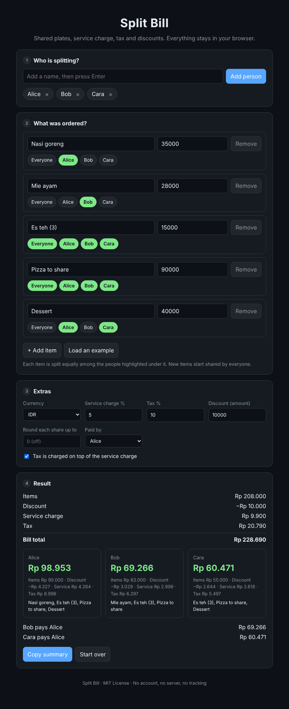

<div align="center">

# split-bill

*Split a restaurant bill fairly: shared plates, service charge, tax, and discounts. Runs entirely in your browser.*




</div>

## Why

Splitting evenly is unfair when one person had a salad and another had steak and drinks. Splitting by hand with service charge and tax on top is slow and easy to get wrong. This tool does it in a minute and shows exactly how each share was calculated.

## Features

- Assign each item to one person, several people, or everyone
- Service charge and tax as percentages, with the option to charge tax on top of the service charge
- Discount shared in proportion to what each person ordered
- Optional rounding of each share (for example up to the nearest 1,000)
- Mark who paid and see who owes whom
- One-tap summary you can paste into any chat
- 11 currencies, with correct decimals (IDR, USD, EUR, GBP, SGD, MYR, THB, PHP, VND, JPY, AUD)
- Works on phones, supports light and dark mode
- Your data stays on your device. No account, no server, no tracking

## Use it

1. Open the live page, or download this repo and open `index.html`.
2. Add everyone who is splitting.
3. Add each item with its price and tap who shared it.
4. Fill in service charge, tax, and discount from the receipt.
5. Read the result, then tap **Copy summary** and send it to the group.

## How the numbers are calculated

1. **Items.** Each item is divided equally among the people selected for it.
2. **Discount.** The discount is subtracted, shared in proportion to each person's item total.
3. **Service charge.** Calculated on the amount after the discount, shared in proportion.
4. **Tax.** Calculated on the amount after the discount, plus the service charge if that option is on, shared in proportion.
5. **Rounding.** If set, each person's total is rounded up to the chosen amount. The group then pays slightly more than the bill, and the tool shows the difference.

All money is handled as whole units (cents, or whole rupiah for currencies without decimals), and leftover units are handed out fairly, so the shares always add up exactly to the bill. Check the order of charges against your receipt, because restaurants differ.

## Project structure

```
split-bill/
├── index.html      page structure
├── style.css       layout, colors, light and dark theme
├── script.js       calculation, rendering, and saving
├── screenshot.png  preview used in this README
└── README.md
```

Keep all three code files in the same folder, because `index.html` loads `style.css` and `script.js` by relative path.

## Publish with GitHub Pages

1. Push the files to your repo.
2. Go to **Settings**, then **Pages**.
3. Under **Build and deployment**, choose **Deploy from a branch**, select `main` and `/ (root)`, then **Save**.
4. After about a minute the site is live at `https://<username>.github.io/split-bill/`.

## Roadmap

- [ ] Shareable link that contains the whole split
- [ ] Per-item quantities
- [ ] Tip option separate from service charge
- [ ] Save past bills
- [ ] Translations

## Contributing

Issues and pull requests are welcome. Please keep the project dependency-free: plain HTML, CSS, and JavaScript, with no build step. If you find a case where the numbers look wrong, open an issue with the receipt values (no personal information).

## License

MIT
